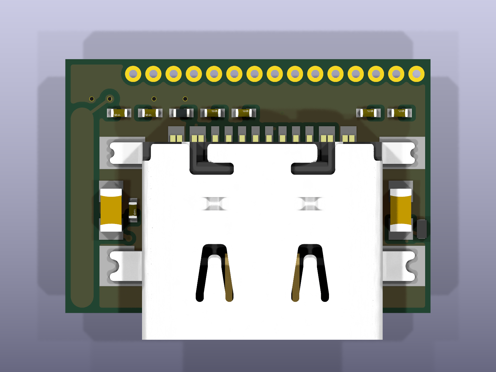
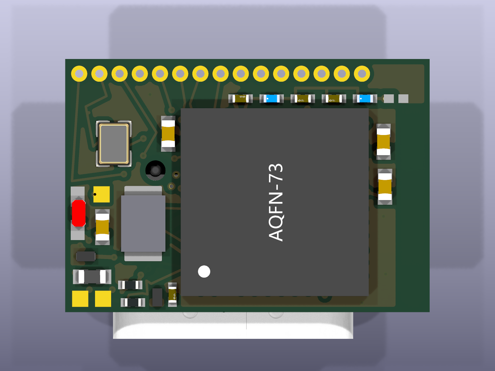
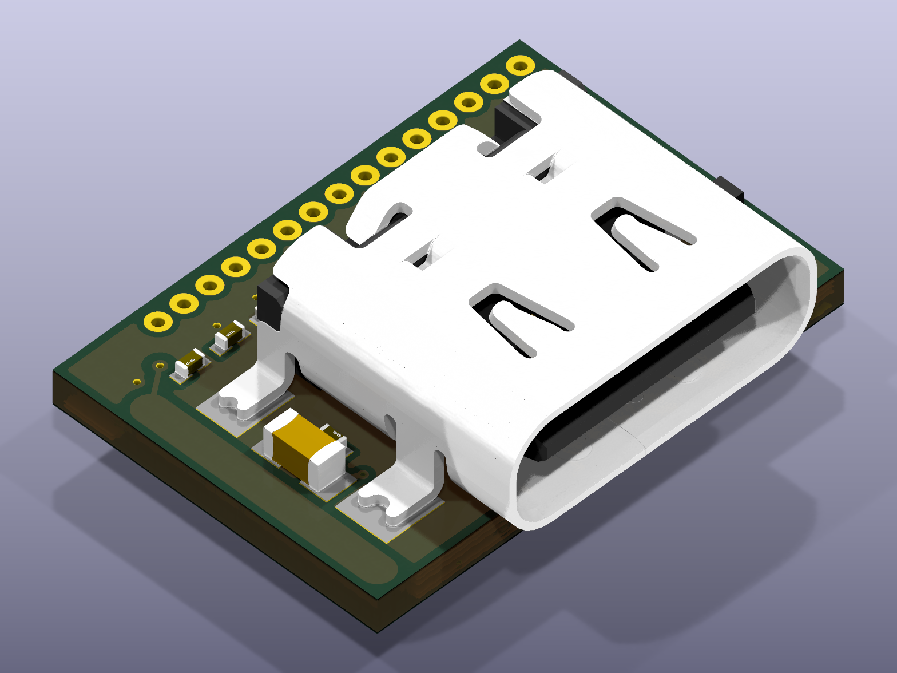

# Meenie Controller

Meenie is a USB-C controller board. The board has a Nordic nRF52840 microcontroller. The board has Bluetooth Low Energy, USB 2.0 data, and 15 GPIO breakout holes. The board has one red status LED and one reset switch. The board has three service lands for SWDIO, SWCLK, and +3V3.

<table>
<tr>
<td></td>
<td></td>
<td></td>
</tr>
</table>

## Specifications

| Item | Value |
|---|---|
| Board size | 13.570 x 9.435 mm |
| Copper layers | 8, in a 3+2+3 sequential HDI stack |
| Finished thickness | 0.991 mm, quoted as a nominal 1.0 mm |
| Microcontroller | Nordic nRF52840-QIAA, aQFN-73, on B.Cu |
| Connector | 16-position USB-C sink receptacle on F.Cu |
| Antenna | Locked track on the F.Cu layer at the west edge |
| Reset switch | C&K NanoT `GSNANOT000102` on B.Cu |
| Surface finish | ENIG |
| Panel | 5 x 7, 35 boards, 89.850 x 92.045 mm |

Read `docs/design.md` for the full stack table and the via inventory.

The short axis of the board is 9.435 mm. NextPCB, for example, has a minimum board size is 10 x 10 mm.

## Repository layout

- `hw/` holds the KiCad schematic, the board, the design rules, and the stack manifest.
- `lib/` holds the symbols, the footprints, and the 3D models.
- `scripts/` holds the release script, the panel tools, and the validation scripts.
- `fab/` holds the fabrication data, written by `scripts/release.sh`.
- `docs/` holds the design specification and the vendor order gate.
- `3d/` holds the 3D build script, the three renders, and the viewer page.

## Build the 3D output
```
python3 3d/build.py
```

## Build the fabrication tree
```
MEENIE_DRY_RUN=1 scripts/release.sh hw/meenie.kicad_pcb
```
